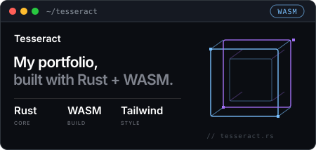
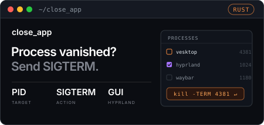
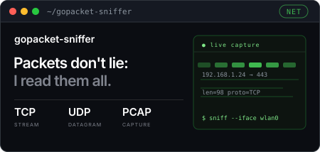
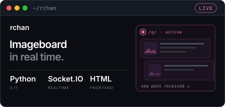
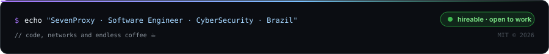

  &nbsp;&nbsp;
    
  &nbsp;&nbsp;
  

  &nbsp;
  &nbsp;
  

🇧🇷 Made in Brazil · <a href="https://github.com/SevenProxy?tab=repositories">see all repos</a> · 🌐 Read in: <a href="README.md">Português</a> · <b>English</b>

